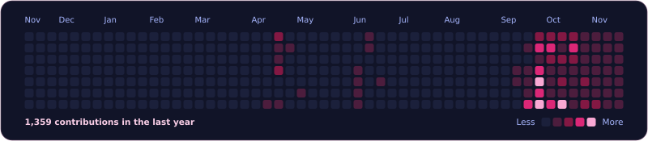

  <!-- HEADER -->
  
    

  <!-- BADGES -->
  &nbsp;
  

---

  <picture>
    <source media="(prefers-color-scheme: dark)" srcset="./assets/zen-heading-tech-stack-dark.svg" />
    <source media="(prefers-color-scheme: light)" srcset="./assets/zen-heading-tech-stack-light.svg" />
    
  </picture>
   
  

---

  <picture>
    <source media="(prefers-color-scheme: dark)" srcset="./assets/zen-heading-statistics-dark.svg" />
    <source media="(prefers-color-scheme: light)" srcset="./assets/zen-heading-statistics-light.svg" />
    
  </picture>
   
  

---

  <picture>
    <source media="(prefers-color-scheme: dark)" srcset="./assets/zen-heading-contributions-dark.svg" />
    <source media="(prefers-color-scheme: light)" srcset="./assets/zen-heading-contributions-light.svg" />
    
  </picture>
   
  <picture>
    <source media="(prefers-color-scheme: dark)" srcset="https://raw.githubusercontent.com/zerabyte88/zerabyte88/output/zen-contrib-dark.svg" />
    <source media="(prefers-color-scheme: light)" srcset="https://raw.githubusercontent.com/zerabyte88/zerabyte88/output/zen-contrib-light.svg" />
    
  </picture>

---

  

