  <!-- HEADER -->
  
    

  <!-- BADGES -->
  &nbsp;
  &nbsp;
  

---

  
  

---

  
  
  

---

  
  <picture>
    <source media="(prefers-color-scheme: dark)" srcset="https://raw.githubusercontent.com/zerabyte88/zerabyte88/output/galaga-contribution-graph-dark.svg">
    <source media="(prefers-color-scheme: light)" srcset="https://raw.githubusercontent.com/zerabyte88/zerabyte88/output/galaga-contribution-graph.svg">
    
  </picture>

---

  

